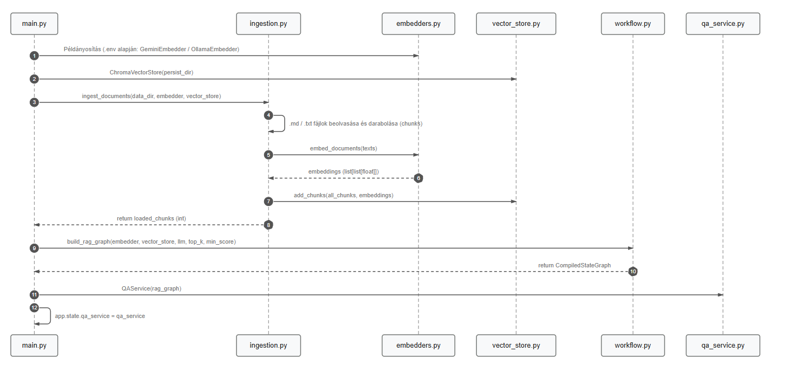
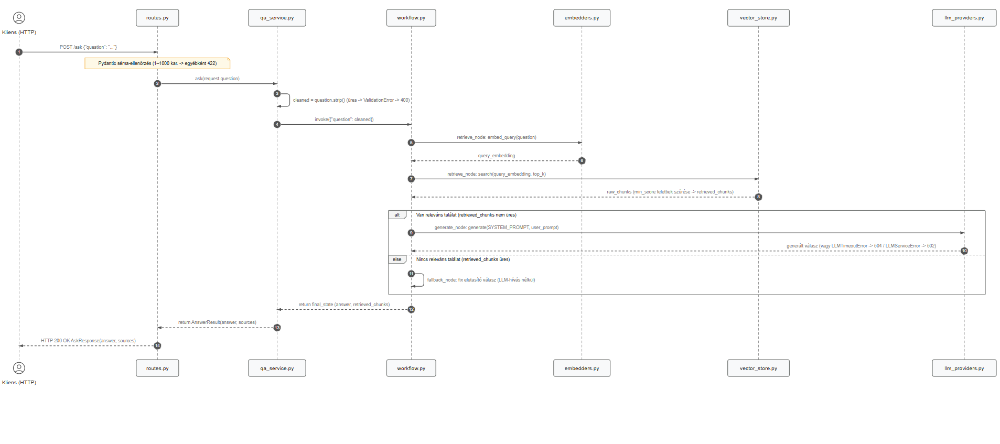
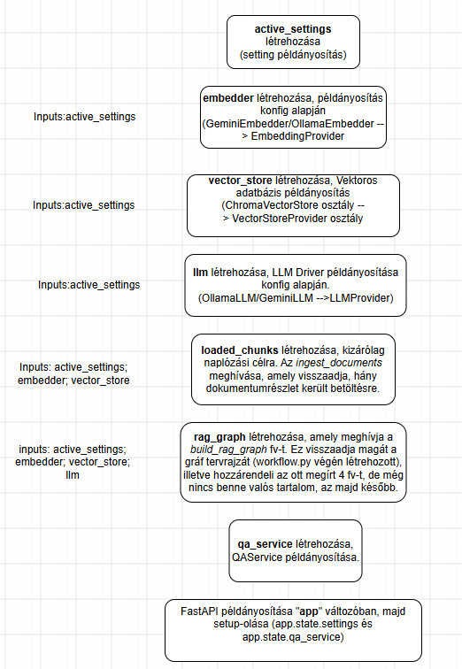
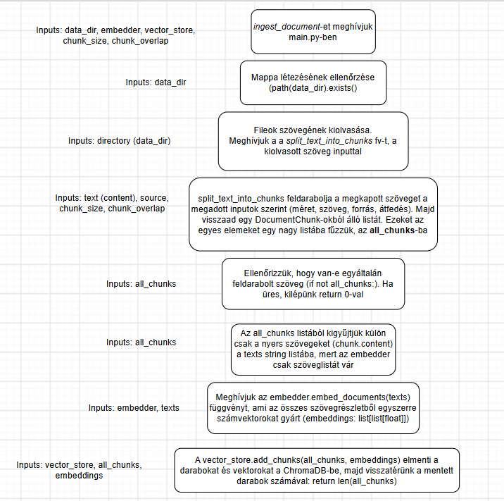
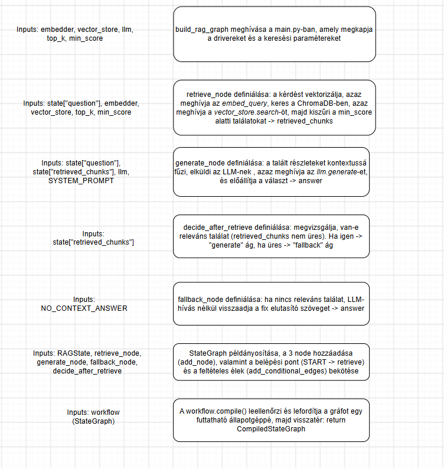
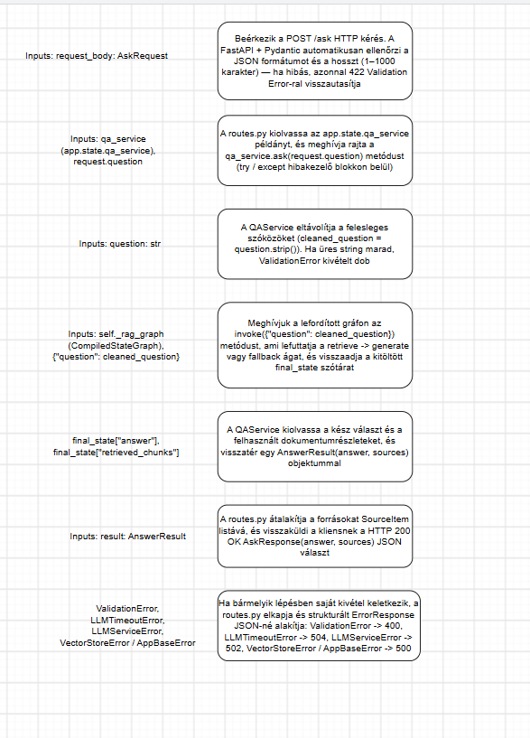

# General Knowledge Assistant – RAG-komponenssel kiegészített backendalkalmazás

Python és FastAPI alapú, reprodukálható REST API backendalkalmazás, amely egy **LangGraph** vezérelt **RAG (Retrieval-Augmented Generation)** munkafolyamaton keresztül válaszolja meg a felhasználói kérdéseket vállalati tudásbázis-dokumentumok alapján.

---

## 1. Problémaválasztás, adatforrás, képességek és korlátok

### Célfelhasználó és valós igény
* **Célfelhasználó:** Vállalati munkavállalók és új belépők, akiknek gyors, pontos válaszokra van szükségük belső szabályzatokkal és munkafolyamatokkal kapcsolatban.
* **Probléma:** A belső irányelvek (távmunka, szabadságolás, jelszó- és VPN-szabályok) több különálló dokumentumban találhatók, amelyek manuális átböngészése időigényes.
* **Megoldás:** A szolgáltatás induláskor automatikusan feldolgozza és vektoradatbázisba tölti a dokumentumokat, majd a `POST /ask` végponton érkező kérdésekhez visszakeresi a releváns szövegrészleteket, és kizárólag ezekre támaszkodva generál választ — feltüntetve a felhasznált forrásdokumentumokat is.

### Mintaadatok
A `data/` könyvtár két fiktív, bizalmas adatot nem tartalmazó minta szabályzatot tartalmaz (`hr_policy.md`, `it_security.md`), így a rendszer külső adatforrás nélkül azonnal kipróbálható.

### Megvalósított képességek
* **Automatikus dokumentumbetöltés induláskor:** A szerver induláskor beolvassa, átfedéses darabokra vágja, vektorizálja és a ChromaDB-be menti a `data/` mappa `.md` és `.txt` fájljait.
* **LangGraph-alapú döntési folyamat:** Visszakeresés (`retrieve`) után relevanciaküszöb (`min_score`) alapján eldönti, hogy LLM-mel generál választ (`generate`), vagy releváns találat hiányában biztonságos elutasító választ ad (`fallback`) LLM-hívás nélkül.
* **Forráshivatkozások:** Minden sikeres válasz tartalmazza a felhasznált dokumentumrészleteket (`chunk_id`, `source`, `content`, `score`).
* **Cserélhető AI-szolgáltatók:** A felhős (**Google Gemini**) és az ingyenes lokális (**Ollama**) mód között kizárólag `.env` konfigurációval lehet váltani, kódmódosítás nélkül.
* **Bemenetellenőrzés, naplózás és hibakezelés:** Egységes naplóformátum és strukturált JSON hibaválaszok (`400`, `422`, `500`, `502`, `504`).

### Ismert korlátok és egyszerűsítések
* Állapotmentes (stateless), egyfordulatos kérdés-válasz: nincs beszélgetési előzmény (chat history).
* Nincs felhasználókezelés, autentikáció vagy dokumentumszintű jogosultságkezelés.
* Nincs futásidőben hívható dokumentumfeltöltő végpont (a tudásbázis szerverindításkor töltődik be).
* Támogatott fájlformátumok (.md és .txt): A rendszer jelenleg kizárólag sima UTF-8 szöveges fájlokat (.md, .txt) dolgoz fel, mert ezek külső dokumentum-parser könyvtárak nélkül, közvetlenül olvashatók. A bináris formátumok (pl. .pdf, .docx) feldolgozása egy következő fejlesztési lépésként külön szövegkinyerő könyvtár (pl. pypdf) beépítésével valósítható meg.

## 2. Rendszerarchitektúra és tervezési döntések

### Könyvtárstruktúra
```text
├── data/                         # Minta tudásbázis-dokumentumok (.md, .txt)
├── docs/images/                  # Architektúra- és folyamatábrák
├── src/
│   ├── api/
│   │   ├── routes.py             # HTTP végpontok (GET /health, POST /ask) és kivétel-leképezés
│   │   └── schemas.py            # Pydantic kérés/válasz/hiba adatmodellek
│   ├── core/
│   │   ├── config.py             # Központi konfigurációkezelés (Pydantic BaseSettings)
│   │   ├── exceptions.py         # Alkalmazásszintű kivételosztályok (AppBaseError)
│   │   └── logging.py            # Egységes naplózási formátum és szintbeállítás
│   ├── domain/
│   │   ├── interfaces.py         # Absztrakt szerződések (EmbeddingProvider, VectorStoreProvider, LLMProvider)
│   │   └── models.py             # Külső függőségektől mentes domain modellek (DocumentChunk, RetrievedChunk)
│   ├── graphs/
│   │   └── workflow.py           # LangGraph StateGraph munkafolyamat (retrieve -> generate / fallback)
│   ├── infrastructure/
│   │   ├── embedders.py          # GeminiEmbedder és OllamaEmbedder implementációk
│   │   ├── llm_providers.py      # GeminiLLM és OllamaLLM implementációk
│   │   └── vector_store.py       # ChromaVectorStore implementáció (koszinusz-hasonlóság)
│   ├── services/
│   │   ├── ingestion.py          # Dokumentumok beolvasása, darabolása és vektoros betöltése
│   │   └── qa_service.py         # Kérdés-válasz üzleti logika (HTTP-független)
│   └── main.py                   # Alkalmazás belépési pont, dependency injection és lifespan
├── tests/                        # Automatizált offline unit/integrációs és élő tesztek
├── Dockerfile                    # Konténerdefiníció (nem-root felhasználóval)
├── docker-compose.yml            # Egyszerű indítás és perzisztens ChromaDB volume
├── pyproject.toml                # Projekt- és pytest konfiguráció
├── requirements.txt              # Közvetlen függőségek
└── requirements.lock.txt         # Rögzített verziójú függőségek
```

### Fő komponensek, adatáramlás és folyamatábrák

#### Dinamikus folyamatok (Szekvenciadiagramok)
1. **Indulási és indexelési folyamat (`Startup & Ingestion`):**
   
2. **Futásidejű kérdés-válasz folyamat (`POST /ask`):**
   

#### Modulszintű működési folyamatok
* **Alkalmazás inicializálása (`src/main.py`):**
  
* **Dokumentum-feldolgozás és indexelés (`src/services/ingestion.py`):**
  
* **LangGraph döntési munkafolyamat (`src/graphs/workflow.py`):**
  
* **HTTP kéréskezelés és üzleti logika (`src/api/routes.py` & `src/services/qa_service.py`):**
  

### Főbb interfészek és függvények paraméterei
* **`EmbeddingProvider` (`src/domain/interfaces.py`):**
  * `embed_documents(texts: list[str])` – `texts`: a feldarabolt dokumentumrészletek szövegeinek listája, amelyeket kötegelve számvektorokká alakít.
  * `embed_query(text: str)` – `text`: a felhasználó bejövő kérdése, amelyet keresési vektorrá alakít.
* **`VectorStoreProvider` (`src/domain/interfaces.py`):**
  * `add_chunks(chunks: list[DocumentChunk], embeddings: list[list[float]])` – `chunks`: a darabolt szövegegységek és metaadataik (`chunk_id`, `content`, `source`); `embeddings`: a hozzájuk tartozó embedding számvektorok ugyanabban a sorrendben.
  * `search(query_embedding: list[float], top_k: int)` – `query_embedding`: a kérdés vektora; `top_k`: a visszaadandó legközelebbi találatok maximális száma.
* **`LLMProvider` (`src/domain/interfaces.py`):**
  * `generate(system_prompt: str, user_prompt: str)` – `system_prompt`: a modell viselkedését és kontextushűségét szabályozó utasítás; `user_prompt`: a visszakeresett dokumentumrészleteket és a kérdést tartalmazó kérés.
* **`ingest_documents(...)` (`src/services/ingestion.py`):**
  * `data_dir`: a forrásdokumentumokat tartalmazó mappa elérési útja; `embedder`: a vektorizáló szolgáltató; `vector_store`: a cél vektoradatbázis; `chunk_size`: egy szövegdarab maximális karakterszáma; `chunk_overlap`: az egymást követő darabok közötti karakterátfedés.
* **`build_rag_graph(...)` (`src/graphs/workflow.py`):**
  * `embedder`, `vector_store`, `llm`: az injektált szolgáltatói interfészek; `top_k`: a lekérdezett találatok száma; `min_score`: az a minimális koszinusz-hasonlósági küszöbérték, amely alatt a találat irrelevánsnak minősül.

### Technikai döntések és kompromisszumok
* **Darabolás (`chunk_size=500`, `chunk_overlap=100`):** Karakteralapú, átfedéses darabolás. *Előnye:* egyszerű, determinisztikus és megakadályozza a mondathatáron történő információvesztést. *Kompromisszuma:* nem követi szigorúan a Markdown fejezethatárokat.
* **Vektoros tároló (`ChromaDB PersistentClient`, koszinusz-tér):** Lokális fájlrendszerre mentő, külön szerverfolyamatot nem igénylő vektortár idempotens `upsert` művelettel (újraindításkor nem duplikálja az elemeket). *Kompromisszuma:* egyetlen konténerpéldány lokális kötetéhez kötött.
* **Relevanciaküszöb (`min_score=0.25`):** A túl gyenge találatok kiszűrésével elkerülhető a hallucináció és a felesleges LLM-hívás.
* **Cserélhetőség és tesztelhetőség:** A `domain/interfaces.py` absztrakt osztályai révén a valódi szolgáltatók a tesztekben memóriabeli `Fake` implementációkkal helyettesíthetők hálózati hívások nélkül.

---

## 3. Telepítés, konfiguráció és indítás

### Környezeti változók (`.env`)
Másold le a minta konfigurációt, és töltsd ki a kívánt értékekkel:
```bash
cp .env.example .env
```

| Változó | Alapértelmezett érték | Leírás |
| :--- | :--- | :--- |
| `LLM_PROVIDER` | `gemini` | Válaszgeneráló szolgáltató (`gemini` vagy `ollama`) |
| `EMBEDDING_PROVIDER` | `gemini` | Embedding szolgáltató (`gemini` vagy `ollama`) |
| `GEMINI_API_KEY` | — | Google Gemini API-kulcs (`gemini` mód esetén kötelező) |
| `GEMINI_LLM_MODEL` | `gemini-3.8-flash` | Használt Gemini nyelvi modell |
| `GEMINI_EMBEDDING_MODEL` | `gemini-embedding-001` | Használt Gemini embedding modell |
| `OLLAMA_BASE_URL` | `http://localhost:11434` | Ollama szerver címe (Dockerből: `http://docker.internal`) |
| `OLLAMA_LLM_MODEL` | `llama3.2` | Lokális Ollama nyelvi modell |
| `OLLAMA_EMBEDDING_MODEL` | `nomic-embed-text` | Lokális Ollama embedding modell |
| `CHROMA_PERSIST_DIR` | `./chroma_db` | ChromaDB perzisztens tárolási könyvtára |
| `DATA_DIR` | `./data` | Tudásbázis-dokumentumok könyvtára |
| `CHUNK_SIZE` | `500` | Szövegdarabok maximális karakterszáma |
| `CHUNK_OVERLAP` | `100` | Szövegdarabok közötti átfedés karakterszáma |
| `RETRIEVAL_TOP_K` | `3` | Visszakeresett legrelevánsabb részletek száma |
| `MIN_SCORE` | `0.25` | Minimális koszinusz-hasonlósági pontszám (`0.0–1.0`) |
| `LLM_TIMEOUT_SECONDS` | `30` | LLM-hívás időkorlátja másodpercben |

### A) Elsődleges mód: Google Gemini (felhős LLM és embedding)
* **Modellválasztás indoklása:** A `gemini-3.8-flash` gyors válaszidőt, alacsony költséget és megbízható magyar nyelvű kontextuskövetést biztosít alacsony hőmérsékleten (`temperature=0.0`), míg a `gemini-embedding-001` pontos szemantikus visszakeresést nyújt.

1. Állítsd be a `.env` fájlban:
   ```env
   LLM_PROVIDER=gemini
   EMBEDDING_PROVIDER=gemini
   GEMINI_API_KEY=sajat_api_kulcsod
   GEMINI_LLM_MODEL=gemini-3.8-flash
   GEMINI_EMBEDDING_MODEL=gemini-embedding-001
   ```
2. Indítás **Docker Compose** segítségével:
   ```bash
   docker compose up --build
   ```
   *(Vagy lokális Python virtuális környezetben: `pip install -r requirements.lock.txt` majd `uvicorn src.main:app --host 0.0.0.0 --port 8000`)*
### B) Ingyenes lokális alternatíva: Ollama (fizetős API-kulcs nélkül)
A teljes RAG-folyamat (mind a dokumentumok/kérdések vektorizálása, mind a válaszgenerálás) futtatható teljesen lokálisan **Ollama** segítségével.

1. **Ollama telepítése és modellek letöltése** *(egyszeri internetkapcsolat szükséges)*:
   * Telepítsd az Ollamát ([ollama.com](https://ollama.com)), majd töltsd le a két modellt:
     ```bash
     ollama pull llama3.2
     ollama pull nomic-embed-text
     ```
2. **Konfiguráció módosítása (kódmódosítás nélkül):**
   * Írd át a `.env` fájlt erre (ha az alkalmazás Dockerben fut, az `OLLAMA_BASE_URL` értéke `http://docker.internal` legyen):
     ```env
     LLM_PROVIDER=ollama
     EMBEDDING_PROVIDER=ollama
     OLLAMA_BASE_URL=http://host.docker.internal:11434
     OLLAMA_LLM_MODEL=llama3.2
     OLLAMA_EMBEDDING_MODEL=nomic-embed-text
     ```
   * *Fontos:* Szolgáltatóváltáskor (3072 dimenziós Gemini embeddingről 768 dimenziós Ollama embeddingre váltáskor) töröld a korábbi vektorindexet:
     ```bash
     docker compose down -v
     docker compose up --build
     ```
3. **Hardverigény és lokális korlátok:**
   * **Hardverigény:** Minimum **8 GB RAM** (ajánlott **16 GB RAM**) és ~3–5 GB szabad tárhely. Dedikált GPU nélkül, CPU-n is futtatható, de a válaszidő 5–20 másodpercre nőhet.
   * **Korlátok:** A kisebb paraméterszámú lokális modellek (pl. 3B paraméteres `llama3.2`) összetett magyar nyelvű szövegeknél pontatlanabbak vagy túlzottan óvatosak lehetnek a felhős modellekhez képest.

---

## 4. Kipróbálható API-kérések

Az alkalmazás elindulása után az interaktív Swagger UI dokumentáció a **`http://localhost:8000/docs`** címen érhető el.

### 1. Állapotellenőrzés (`GET /health`)
```bash
curl -X GET http://localhost:8000/health
```
Válasz (`200 OK`):
```json
{
  "status": "ok",
  "llm_provider": "gemini",
  "embedding_provider": "gemini"
}
```

### 2. Sikeres kérdés-válasz (`POST /ask` — releváns találattal)
```bash
curl -X POST http://localhost:8000/ask \
  -H "Content-Type: application/json" \
  -d '{"question": "Hány nap home office engedélyezett hetente?"}'
```
Válasz (`200 OK`):
```json
{
  "answer": "Sikeres próbaidő után a munkavállalók heti maximum 3 napot dolgozhatnak távmunkában (home office).",
  "sources": [
    {
      "chunk_id": "hr_policy.md_0",
      "source": "hr_policy.md",
      "content": "# HR Szabályzat...",
      "score": 0.7842
    }
  ]
}
```

### 3. Irreleváns kérdés (`POST /ask` — fallback ág, nincs találat)
```bash
curl -X POST http://localhost:8000/ask \
  -H "Content-Type: application/json" \
  -d '{"question": "Milyen recept szerint készül a gulyásleves?"}'
```
Válasz (`200 OK`, üres forráslistával):
```json
{
  "answer": "Sajnos a rendelkezésre álló vállalati dokumentumokban nem találtam releváns információt a kérdés megválaszolásához.",
  "sources": []
}
```

### 4. Hibás bemenet (`POST /ask` — validációs hiba)
```bash
curl -X POST http://localhost:8000/ask \
  -H "Content-Type: application/json" \
  -d '{"question": "   "}'
```
Válasz (`400 Bad Request`):
```json
{
  "error": "ValidationError",
  "detail": "A kérdés nem lehet üres."
}
```

---

## 5. Tesztek futtatása

* **Alapértelmezett offline tesztek (API-kulcs és hálózat nélkül, `Fake` szolgáltatókkal):**
  ```bash
  pytest -v
  ```
  Ellenőrzi a szövegdarabolást, a LangGraph `generate` és `fallback` ágait, a bemenet-validációt (`400`, `422`), az LLM időtúllépést (`504`), a szolgáltatói hibát (`502`), valamint a teljes end-to-end alkalmazásfolyamatot.

* **Élő integrációs próba (valódi `.env`-ben beállított LLM/embedding szolgáltatóval):**
  ```bash
  pytest -m live -v
  ```

---

## 6. Konkurens felhasználók és skálázhatóság

### Kérések elkülönítése
* **Megvalósítva:** A FastAPI végpontok állapotmentesek, nem használnak kérés-szintű globális változókat; minden `POST /ask` hívás saját lokális `RAGState` szótárban futtatja a LangGraph gráfot, így a párhuzamos kérések adatai nem keverednek.
* **Következő lépés:** Több bérlő (multi-tenant) vagy eltérő jogosultsági szintek esetén felhasználói kontextuson alapuló metaadat-szűrés bevezetése a vektoros keresésbe.

### Párhuzamos végrehajtás
* **Megvalósítva:** Szinkron végpontok (`def ask_question`), amelyeket az Uvicorn worker threadpoolban szolgál ki, az induláskori indexelés pedig szinkron fut le a szerver indulásakor.
* **Következő lépés:** Az I/O-blokkoló embedding és LLM hálózati hívások átállítása teljesen aszinkron (`async def` + `httpx.AsyncClient` / `ainvoke`) végrehajtásra, valamint a dokumentum-indexelés kiszervezése aszinkron háttér-workerbe (pl. Celery / Redis Queue).

### Erőforráskorlátok
* **Megvalósítva:** Konfigurálható modell-időkorlát (`LLM_TIMEOUT_SECONDS`), maximális találatszám (`RETRIEVAL_TOP_K`) és bemeneti hosszkorlát (`max_length=1000`), valamint egységes `504`/`502` hibakezelés.
* **Következő lépés:** Exponenciális visszalépéses újrapróbálkozás (retry + jitter) az átmeneti `429`/`503` API-hibákra, kimenő hívások egyidejűségének korlátozása szemafórral (`asyncio.Semaphore`), valamint végpontszintű rate limiting bevezetése.

### Több alkalmazáspéldány
* **Megvalósítva:** Az alkalmazáslogika állapotmentes, de a beágyazott lokális `ChromaDB PersistentClient` fájlrendszeri zárolása miatt jelenleg egyetlen példány futtatható biztonságosan.
* **Következő lépés:** A vektoradatbázis kiszervezése külön dedikált hálózati szolgáltatásba (pl. ChromaDB kliens-szerver mód, Qdrant vagy PostgreSQL `pgvector`), amivel a FastAPI konténerek teljesen állapotmentessé válnak és load balancer mögött horizontálisan skálázhatók.

### Szűk keresztmetszetek és továbbfejlesztési sorrend
* **Fő korlátok:** Külső LLM API válaszideje (1–5 mp) és token/perc rate limitjei; lokális Ollama módban pedig a CPU/GPU számítási kapacitás és a RAM sávszélesség.
* **Figyelt metrikák és fejlesztési sorrend:** Végpontszintű válaszidő (átlagos és kiugró lassulások mérése), külső LLM hívások hibaaránya (`502`/`504`) és tokenfelhasználás monitorozása (Prometheus/OpenTelemetry) → először aszinkron I/O + retry/rate-limit bevezetése → majd külső vektortár + horizontális skálázás → végül gyakori kérdések/embeddingek gyorsítótárazása (Redis) és streaming válaszadás (SSE).
